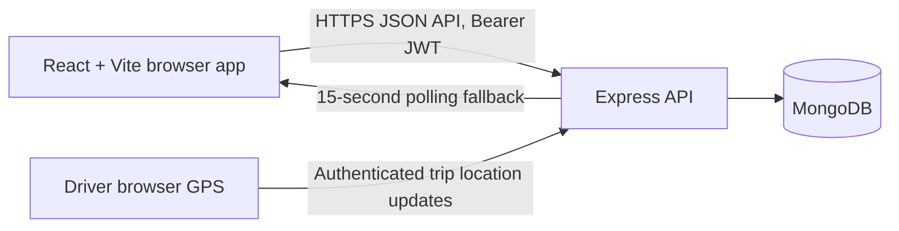
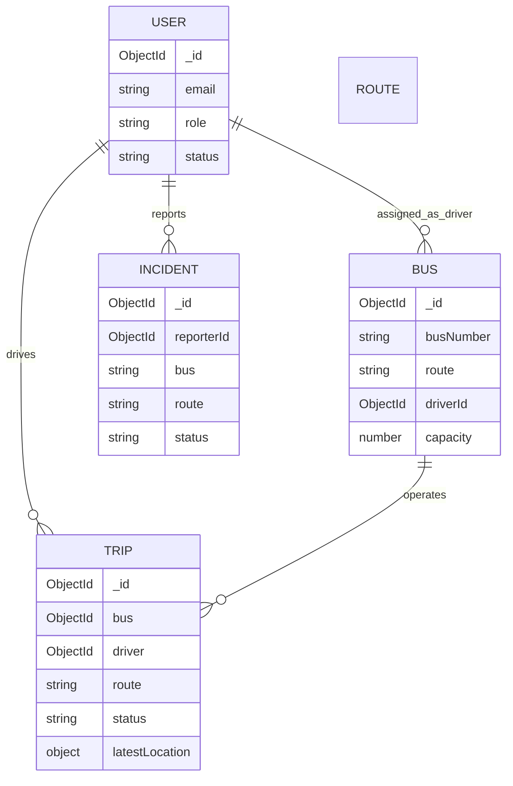

# SmartTransit architecture

## Runtime shape

The API is the source of truth for user status and role. JWT identity is resolved to the current MongoDB user on every protected request. Browser-held bearer tokens use the existing `localStorage` architecture; an XSS attack could access them, so use HTTPS, keep dependencies patched, and avoid untrusted HTML.

## Data model

`Bus.route` and `Route.bus` are legacy text fields and are not foreign-key relationships. `Trip.route` snapshots the bus route label at trip start. The `latestLocation` field stores only the most recent accepted device location, not a location history. Existing buses remain valid with no `driverId`; an administrator must link an active driver account before that bus can start an authenticated trip.

Adding `Incident.reporterId` is non-destructive and optional for existing records. Old incidents without that relationship remain visible to administrators, while users only see incident reports created after this relationship is populated for them.

## Operational behavior and boundaries

- Only active users with a valid signed JWT can access protected API routes.
- Public student registrations are activated as students; public driver/admin requests retain effective student permissions and are blocked from protected operations until an administrator approves them. Existing records default to approved when the new approval field is absent.
- Admin role is checked on the server for fleet/route/user changes, incident review, and analytics.
- Drivers can start a trip only for an active bus assigned to their account.
- Location updates are accepted only from the active trip's assigned driver and are timestamped by the server.
- Students and administrators see active trip locations by polling every 15 seconds. Stale GPS is explicitly labeled after two minutes.
- No Socket.IO transport, route geometry, history playback, traffic feed, or ETA calculation is currently configured.
- The browser must provide geolocation permission and a secure context (HTTPS, or localhost for development).
